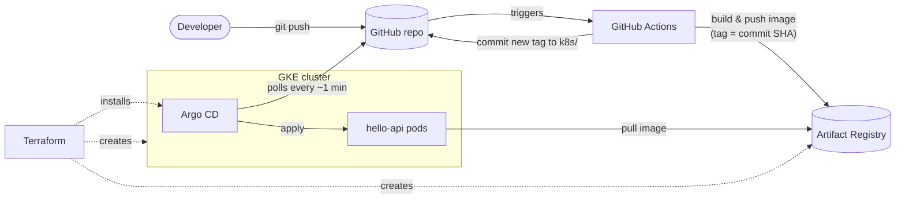

# GKE GitOps demo

A small web service deployed to Google Kubernetes Engine through a fully automated pipeline:

- **Terraform** creates the infrastructure: network, GKE cluster, container registry, CI identity, and Argo CD.
- **GitHub Actions** tests the code, builds a container image, and records the new image tag in Git.
- **Argo CD** runs inside the cluster and keeps it in sync with what Git says should be running.

A `git push` to `main` ends with the new version serving traffic, and nothing in the pipeline holds credentials to the cluster.

## How it works



1. A push to `main` that touches `app/` starts the [`app` workflow](.github/workflows/app.yaml). It runs `go vet` and the tests.
2. The workflow authenticates to Google Cloud without a key (see [keyless CI](#keyless-ci-authentication)). It builds the image and pushes it to Artifact Registry, tagged with the full commit SHA.
3. It runs `kustomize edit set image` in `k8s/` and commits the change to `main`.
4. Argo CD sees the new commit, renders `k8s/` with Kustomize, and applies it. Kubernetes rolls out the new pods one at a time and only sends them traffic once they pass their readiness checks.

**GitHub Actions never talks to the cluster.** It only writes to Git and the registry, and Argo CD pulls changes in. Every deployment is therefore a Git commit, which gives an audit trail, code review, and `git revert` as the rollback mechanism. The cluster also can't quietly drift: Argo CD reverts manual changes.

## Repository layout

```
app/                    Go service (standard library only) + Dockerfile
k8s/                    What Argo CD deploys: Kustomize manifests for hello-api
argocd/                 Argo CD's own config: an AppProject and the hello-api Application
terraform/              GCP infrastructure and the Argo CD install
scripts/bootstrap.sh    One-time setup: enables base APIs, creates the Terraform state bucket
.github/workflows/
  app.yaml              Test -> build -> push -> release (commit new image tag)
  infra.yaml            terraform fmt/validate, Kubernetes schema validation
```

### The service

`hello-api` is a minimal Go HTTP server:

| Endpoint   | Purpose |
|------------|---------|
| `GET /`        | `{"service":"hello-api","message":"Hello from GKE","version":"<commit sha>"}` |
| `GET /healthz` | Liveness probe |
| `GET /readyz`  | Readiness probe; returns 503 while shutting down |

The commit SHA is compiled into the binary, so `curl` shows exactly which commit is live. On `SIGTERM` it stops reporting ready, keeps serving for 5 seconds while the load balancer catches up, then shuts down gracefully. That way rolling updates don't drop requests.

## Design decisions

### GitOps with an "app of apps"

Terraform installs Argo CD and creates exactly one Argo CD Application, `root`, which points at `argocd/`. Everything else Argo CD manages is defined in that directory, in Git. Adding a second service means adding YAML to `argocd/`, with no Terraform change.

The `hello-api` Application belongs to its own [AppProject](argocd/project.yaml). The project only allows deploying from this repository into the `hello-api` namespace, so a bad manifest can't reach anything else in the cluster.

### Keyless CI authentication

GitHub Actions authenticates to Google Cloud with [Workload Identity Federation](terraform/github.tf):

1. Each run gets a short-lived OIDC token from GitHub.
2. Google accepts the token only if it was issued for **this repository** on the **`main` branch**.
3. The run then acts as the `github-ci` service account for about an hour.

No service account key exists, so there's nothing to leak or rotate. Pull requests still run tests but can't push images. The `github-ci` account has a single permission: write access to one Artifact Registry repository.

### Immutable, traceable images

Images are tagged with the full commit SHA, and the registry has [immutable tags](terraform/registry.tf) turned on, so a tag can never be repointed. The tag in `k8s/kustomization.yaml` therefore identifies exactly what's running, down to the source commit. Artifact Registry also scans each pushed image for known vulnerabilities.

### Least privilege throughout

- **Nodes** run as a dedicated service account with GKE's minimal node role plus read access to the one registry. They don't use the broad Compute Engine default account.
- **Nodes have private IPs only.** Outbound traffic, such as Argo CD pulling from GitHub, goes through Cloud NAT. The control plane endpoint is public but requires Google IAM authentication.
- **Pods** run in a namespace that enforces the Kubernetes [`restricted`](https://kubernetes.io/docs/concepts/security/pod-security-standards/#restricted) security profile:
  - non-root user, read-only root filesystem, no Linux capabilities, default seccomp profile
  - no service account token mounted
  - a distroless base image with no shell
- **Network**: a [NetworkPolicy](k8s/networkpolicy.yaml) allows inbound traffic on the HTTP port only and blocks all outbound traffic, since the service has no dependencies. GKE Dataplane V2 enforces it.

### Availability

There are two replicas, spread across nodes where possible. Rolling updates use `maxUnavailable: 0`, and a PodDisruptionBudget keeps one pod up during node upgrades. The node pool autoscales between 1 and 3 nodes and repairs and upgrades itself on GKE's Regular release channel.

### Configuration changes without a rebuild

`GREETING` lives in a Kustomize `configMapGenerator`. Changing it in Git changes the generated ConfigMap's name, which changes the pod template, so Argo CD performs a normal rolling update. No CI run is needed.

### Terraform is run by a person; CI only checks it

The `infra` workflow runs `terraform fmt` and `terraform validate` and checks every Kubernetes manifest against its schema. It doesn't run `terraform apply`. Applying would require CI to hold project-admin-level permissions, and the infrastructure here changes rarely. For production, see [next steps](#production-next-steps).

State is stored in a versioned GCS bucket, and `.terraform.lock.hcl` is committed so everyone uses identical provider builds.

## Setup

You need:

- a Google Cloud project with billing enabled
- a **public** GitHub repository holding this code. Argo CD reads it without credentials; a private repo needs a deploy key added to Argo CD.
- [Cloud Shell](https://shell.cloud.google.com), which already has `gcloud` and `kubectl`, or a local machine with those tools. You also need Terraform 1.5 or newer. Cloud Shell doesn't include it, so install it into `~/bin`, which persists between sessions:

  ```bash
  mkdir -p ~/bin
  curl -fsSLo /tmp/terraform.zip https://releases.hashicorp.com/terraform/1.16.6/terraform_1.16.6_linux_amd64.zip
  unzip -o /tmp/terraform.zip terraform -d ~/bin && export PATH="$HOME/bin:$PATH"
  terraform version
  ```

### 1. Push the code to GitHub

Push this repository to `main`. The `app` workflow runs the tests and skips the build, because the cloud side doesn't exist yet.

### 2. Create the infrastructure

In Cloud Shell:

```bash
git clone https://github.com/<you>/<repo>.git && cd <repo>
gcloud config set project <project-id>

scripts/bootstrap.sh <project-id>

cd terraform
cp terraform.tfvars.example terraform.tfvars   # then edit both values
terraform init -backend-config="bucket=<project-id>-tfstate"
terraform apply
```

`apply` takes about 10–15 minutes, mostly creating the cluster.

### 3. Connect GitHub Actions to Google Cloud

```bash
terraform output github_actions_variables
```

Add each value as a repository **variable** under *Settings → Secrets and variables → Actions → Variables*. None of them are secret. With the GitHub CLI:

```bash
terraform output -json github_actions_variables \
  | jq -r 'to_entries[] | "\(.key) \(.value)"' \
  | while read -r k v; do gh variable set "$k" --body "$v" --repo <you>/<repo>; done
```

### 4. Deploy

Run the `app` workflow: *Actions → app → Run workflow*. It builds the image, pushes it, and commits the new tag to `k8s/`. Within a minute or two Argo CD rolls it out.

```bash
$(terraform output -raw get_credentials_command)
kubectl -n hello-api get pods,svc
curl http://<EXTERNAL-IP>/
```

The load balancer IP can take a minute or two to appear.

### Argo CD UI

```bash
kubectl -n argocd get secret argocd-initial-admin-secret -o jsonpath='{.data.password}' | base64 -d; echo
kubectl -n argocd port-forward svc/argocd-server 8080:443
```

Open https://localhost:8080 and log in as `admin`. The certificate is self-signed. In Cloud Shell, use *Web Preview* on port 8080.

## Things to try

| Try this | What happens |
|---|---|
| Change the message in `app/main.go` and push | CI builds a new image and commits the tag; Argo CD rolls it out; `curl` shows the new `version` |
| Change `GREETING` in `k8s/kustomization.yaml` and push | No CI build; Argo CD rolls the pods with the new config |
| `kubectl -n hello-api scale deploy/hello-api --replicas=5` | Argo CD's self-heal puts it back to 2 |
| `git revert <release commit>` and push | Argo CD redeploys the previous image |

## Teardown

Delete the app through Argo CD first, so Kubernetes removes the load balancer it created. Load balancers left behind keep the network in use, and `terraform destroy` would fail on it.

Run from the repository root:

```bash
kubectl -n argocd delete application root        # stop Argo CD recreating hello-api
kubectl -n argocd delete application hello-api   # waits while the namespace and load balancer are removed
(cd terraform && terraform destroy)
```

Once `terraform destroy` reports `Destroy complete!`, you can also delete the state bucket. Don't delete it earlier: Terraform needs the state to know what to destroy.

```bash
gcloud storage rm -r "gs://$(gcloud config get-value project)-tfstate"
```

## Cost

Roughly $2–5 a day while running: one or two `e2-standard-2` nodes, a network load balancer, Cloud NAT and disks. GKE's free tier covers the cluster management fee for one zonal cluster per billing account. Run the teardown when you're done.

## Production next steps

This is sized for a demo. For production I would add:

- **Environments and promotion**: Kustomize overlays (or a separate config repository) for dev, staging and prod. Releases would move between them by pull request, not direct commits to `main`.
- **Protected `main`**: required reviews and status checks. The release step would open a pull request, or push as a GitHub App with a bypass rule.
- **Terraform in CI**: `plan` on pull requests and `apply` on merge, using a separate federated identity and a GitHub environment with required approvers.
- **Traffic**: Gateway API or Ingress with Google-managed TLS certificates and Cloud Armor, instead of a plain L4 load balancer.
- **Supply chain**: signed images (cosign) enforced by Binary Authorization, SBOMs, and failing the build on critical vulnerabilities.
- **Argo CD**: SSO with RBAC instead of the admin account, a GitHub webhook instead of polling, and notifications for failed syncs.
- **Secrets**: Secret Manager with Workload Identity (already turned on in the cluster) through the External Secrets Operator.
- **Cluster**: a regional control plane, restricted control plane access, and Google Cloud Managed Service for Prometheus with alerts.
- **Scaling**: a HorizontalPodAutoscaler for the service.

## Troubleshooting

- **`bootstrap.sh` fails with "The billing account for the owning project is disabled"**: the project isn't linked to a billing account. Find yours with `gcloud billing accounts list`, then run `gcloud billing projects link <project-id> --billing-account=<ACCOUNT_ID>`.
- **`apply` fails with "API not enabled" or "has not been used in project"**: newly enabled APIs can take a minute to become usable. Run `terraform apply` again.
- **Re-applying after a destroy fails on the workload identity pool**: deleted pools are kept for 30 days. Restore it with `gcloud iam workload-identity-pools undelete github --location=global`, then apply again.
- **The `root` Application shows "repository not found"**: the repository must be public, and `github_repository` must match its exact owner/name.
- **Pods in `ImagePullBackOff` with tag `initial`**: the `app` workflow hasn't released an image yet. Run it (step 4).
- **The workflow fails at "Log in to Artifact Registry"**: check the three repository variables, and that `github_repository` matches the repository name exactly, including capitalization.
